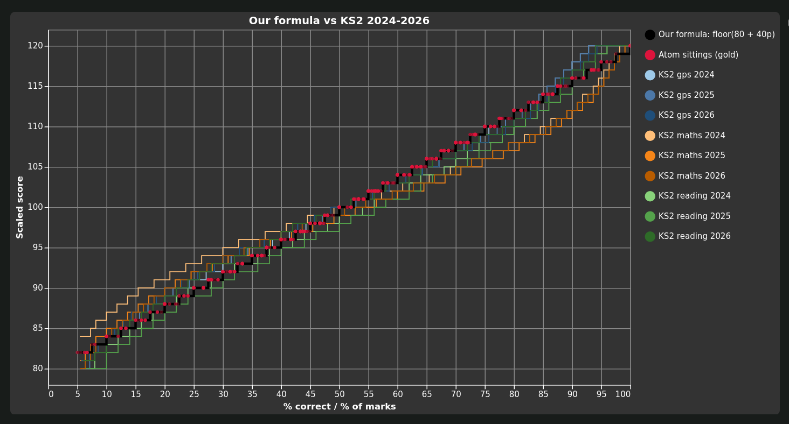
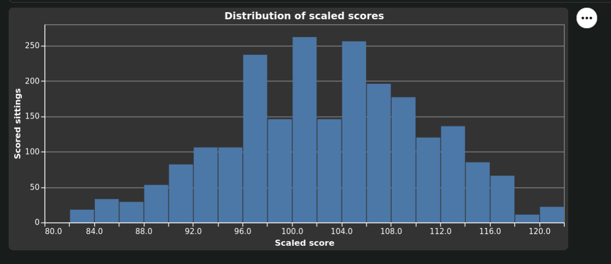

# Atom SATs scores

## Introduction

dbt models (BigQuery) that give every pupil a KS2 SATs-style scaled score
(80–120) in every subject, based on their responses to Atom assessments, plus
a written answer on predicting GCSE results.

- **The brief:** [`reference_docs/take_home_task_content.md`](reference_docs/take_home_task_content.md).
  The GOV.UK scaled-score guidance is in
  [`reference_docs/gov_scaled_conversion_tables.md`](reference_docs/gov_scaled_conversion_tables.md).
- **Start here:** the gold model
  [`models/gold/gold__pupil_subject_scores.sql`](models/gold/gold__pupil_subject_scores.sql)
  and [`notebooks/03_reconciliation.py`](notebooks/03_reconciliation.py),
  which reconciles it against the official KS2 conversion tables (its main
  charts are embedded under Question 1). The GitHub repository and its pull
  requests are private; I can grant access on request.
- **Design decisions:**
  [ADR 0001](docs/adr/0001-scoring-data-model.md) (data model and point in
  time) and [ADR 0002](docs/adr/0002-scaled-score-curve.md) (how % correct
  becomes a scaled score).
- **Notebooks** (marimo, `uv run marimo edit notebooks/<name>.py`):
  `01_exploration` (data profiling), `02_conversion_curves` (choosing the
  formula), `03_reconciliation` (our scores vs the official KS2 tables).

The project uses medallion layers, all built into one BigQuery dataset (we can
only write to one), separated by folder and the `<layer>__<entity>` model-name
prefix:

| Layer  | Folder           | Contents |
|--------|------------------|----------|
| bronze | `models/bronze/` | The raw `de_raw` tables, declared as dbt sources with data-quality tests. |
| silver | `models/silver/` | Sittings with scoring rules as flags, de-duplicated answers, and a score per sitting. |
| gold   | `models/gold/`   | `gold__pupil_subject_scores`: the scaled-score history per pupil and subject. |

## Setup

**Prerequisites**

- **[uv](https://docs.astral.sh/uv/getting-started/installation/)** manages
  the Python environment and installs the right Python version (3.12) itself.
  Other tools such as pip or Poetry aren't supported: the pinned versions live
  in `uv.lock`, and `pyproject.toml` uses uv-specific settings
  (`[tool.uv] override-dependencies`, which keeps a dbt dependency that fails
  to build on some machines out of the install, and `[dependency-groups]` for
  the dev tools).
- **[gcloud CLI](https://cloud.google.com/sdk/docs/install)**, logged in with
  access to the `atom-analytics-candidates` BigQuery project.
- **make** and **git**.

**Quick start**

```sh
gcloud auth application-default login   # dbt `dev` target uses your gcloud credentials
make setup                              # uv sync, dbt deps, install pre-push hook
make build                              # dbt build (models + seeds + tests)
make check                              # all repo checks (also run on pre-push and in CI)
```

Defaults point at project `atom-analytics-candidates`, dataset `owen_cain`.
Override with `DBT_GCP_PROJECT` / `DBT_DATASET`.

**Running it**

- `make build` runs `dbt build`: models, seeds, data tests and unit tests.
  `silver__answers` and `silver__sitting_scores` are incremental, so a normal
  run only reprocesses the last `answers_lookback_days` (3) days of answers.
- **Schedule a full refresh** (`dbt build --full-refresh`, e.g. weekly). The
  raw tables have no updated-at timestamps, so a response changed after the
  lookback window is only picked up by a full refresh. Changes to sittings and
  pupils (deletes, completions) are picked up by every normal run.
- To rebuild a date range of answers: `dbt build --select silver__answers+
  --event-time-start 2026-01-01 --event-time-end 2026-02-01`.

## Question 1: Score every pupil, in every subject, on the KS2 80–120 scale

### What I built

`gold__pupil_subject_scores` (BigQuery `owen_cain`): a KS2-style scaled score
for every pupil in every subject they have a scorable sitting in, as a
**type-2 history**, one row per scored sitting.

```sql
-- current scores
select * from owen_cain.gold__pupil_subject_scores where is_current;

-- scores as they stood at time T
select * from owen_cain.gold__pupil_subject_scores
where valid_from <= @t and (valid_to > @t or valid_to is null);
```

```
de_raw (sources, bronze) ─┬─ silver__sittings        every sitting + is_scorable / exclusion_reason
                          └─ silver__answers         one answer per (sitting, question), duplicates collapsed
                               └─ silver__sitting_scores  floor(80 + 40 * correct / questions)
                                       └─ gold__pupil_subject_scores  type-2 history per pupil × subject
```

- `macros/ks2_scaled_score.sql`: the scoring formula, in one place; the
  minimum for a score is a dbt var in `dbt_project.yml`.
- `seeds/ks2_scaled_score_conversion.csv`: official KS2 tables (2024-2026),
  used to calibrate and check the formula, not for scoring.

### Results

Both charts come from
[`notebooks/03_reconciliation.py`](notebooks/03_reconciliation.py).

**Our scores are close to the official GOV.UK conversions.**



The black line is our formula, `floor(80 + 40p)` (`p` = proportion of
questions correct). The coloured lines are the official KS2 conversion tables
published on GOV.UK for 2024-2026 (reading, maths, and grammar, punctuation and
spelling), plotted against the % of marks available. The red dots are the
scored Atom sittings. Our line runs through the middle of the official curves:

- On average it is within about 1 point of the GPS and reading tables and
  about 2 points of the maths tables (at most 5 points), similar to how much
  the official tables differ from one year to the next.
- It agrees with the official tables on whether a pupil met the expected
  standard (100) for 94-100% of raw scores.
- It is furthest from maths at the extremes, where the official maths curve is
  steepest.

**The distribution could be more even.**



Scores bunch in the middle of the scale: across all 2,287 scored sittings the
mean is 102, the middle half is 96-108 and about two thirds fall in 95-109,
while the ends of the 80-120 range are barely used. That makes it hard to tell
pupils in the middle apart. The comb-like pattern comes from common sitting
lengths: with 25 questions, for example, scores move in steps of 1.6 points,
so some scores occur more often than their neighbours.

### Data quality issues

Evidence for each is in [`notebooks/01_exploration.py`](notebooks/01_exploration.py).

- **Orphan responses:** 1,433 `responses` rows (56 sessions) reference a
  `session_id` missing from `assessment_sittings`.
- **Duplicate responses:** 2,082 `(session_id, question_id)` pairs have more
  than one row (4,493 rows), all in complete summative fixed-question sittings.
  Copies share `answered_at`, `seconds_taken` and `question_number` but have
  distinct `response_id`s, and in 965 pairs they disagree on `is_correct`.
  The copy count varies by pupil for the same question, so these are not
  multi-mark questions; they sit inside one sitting, so they are not re-sits.
- **`responses.session_type`** is always `MOCK_TEST` and never matches the
  sitting's `session_type`.
- **Late answers:** 1,608 responses have `answered_at` after the sitting's
  `finished_at`, but by at most 1 second (timestamp rounding). Only
  incomplete sittings lack a `finished_at`.
- **Soft deletes:** no pupil or sitting is currently marked `is_deleted`.
- **Year groups:** 25 sittings (entrance exams) are in years 11, 14 and 15.
- **Unused rows:** 61 pupils have no sittings, 79 sittings have no responses,
  and 8,096 of 10,552 questions in `course_hierarchy` have never been answered.

### Assumptions

Scoring follows the KS2 rules in the GOV.UK guidance where they apply.

- **Conversion to the 80-120 scale:** linear rescaling for every subject,
  `floor(80 + 40p)` (0% → 80, 50% → 100, 100% → 120); no score (`N`) below 5%,
  never rounded up to 80. The official tables aren't applied directly because
  an Atom assessment isn't the KS2 paper they were calibrated on
  ([ADR 0002](docs/adr/0002-scaled-score-curve.md)).
- **An Atom assessment is about as hard as a KS2 paper**, and one question is
  worth one mark.
- **Subjects:** every subject with qualifying sittings is scored (English,
  Maths, Screeners, Verbal and Non-Verbal Reasoning). Science has questions
  but no sittings; Wellbeing sittings are all surveys (no right answers).
- **Qualifying sittings:** complete, not deleted, not a survey and not an
  adaptive mock (adaptive difficulty makes % correct incomparable), year group
  1-6. KS2 precedent: a pupil must sit every paper to receive a score.
- **Orphan responses** are excluded: without a sitting we can't apply the rules
  above.
- **Duplicates** are treated as an upstream double-submission bug: one answer
  per (sitting, question), correct only if every copy is correct. Mean %
  correct moves by under 2 points under "any copy correct" instead.
- **No-attempts** count as wrong (0 marks), as an unanswered KS2 question does.
- **Late answers** are kept (they are at most 1 second late).
- **Unit of scoring:** each qualifying sitting is scored on its own (KS2 never
  pools attempts). A pupil's score as of time T is their latest scored sitting
  finished at or before T.
- **Missing questions:** 49 sittings have fewer answers than
  `total_questions`. The proportion correct uses the answered questions only,
  as if the missing ones weren't asked, because we can't tell a skipped
  question from one that was never recorded.

### What I would do next

- **A curve that spreads scores out more evenly.** Options: a steeper curve
  through the middle (the logit in ADR 0002 is *flatter* there, so it would
  bunch scores further), or calibrating to the national KS2 scaled-score
  distribution, i.e. mapping each pupil's percentile among Atom pupils of the
  same year group to the national score at that percentile. Either would need
  a new `scoring_method`.
- **Adjust for question difficulty:** estimate each question's difficulty from
  Atom responses, removing the "as hard as a KS2 paper" assumption once there
  is enough data.

## Question 2: Build tables that are re-runnable, point-in-time and ready for 100m+ rows

How the models meet the brief's "built to last" requirements. Details are in
[ADR 0001](docs/adr/0001-scoring-data-model.md).

### What I built

- **Re-runnable:** keys are hashes of natural keys (no random IDs or
  timestamps), daily batches and sittings are replaced whole, and small tables
  are rebuilt every run. Checked: running twice gives identical tables, and an
  incremental build gives the same tables as a full refresh.
- **Incremental for 100m+ responses:** `silver__answers` is built in daily
  batches (dbt microbatch, 3-day lookback, partitioned by day, clustered by
  sitting); `silver__sitting_scores` merges only sittings with new answers.
  A normal run reprocesses 4 days.
- **Point in time:** gold is a type-2 history (`valid_from` / `valid_to` /
  `is_current`), so any pupil's score can be recomputed as it stood at time T.
- **Deletes and corrections flow through:** sitting and pupil rules are
  applied in gold, which is rebuilt every run, so a deleted sitting or pupil
  disappears on the next run.
- **Tested and documented:** every column has a description; data tests
  (unique keys, 80-120 range, one current row, unbroken history) and unit
  tests (de-duplication, formula edge cases, incremental logic, history) run
  in every `dbt build`, including the pre-push hook.

### Assumptions

- **"As it stood at time T" means the pupil's actual score at T**, from the
  sittings finished by then, not what the warehouse showed at T. Corrections
  and deletions therefore apply retroactively.
- **A deleted pupil is erased:** their history disappears from gold.
- **Late changes:** the raw tables have no updated-at timestamps, so a
  response changed more than 3 days later is only picked up by a full
  refresh.

### What I would do next

- **Model contracts:** enforce column names, data types and `not_null` /
  primary-key constraints, so a schema change fails the build instead of
  reaching the application database.
- **Partition `de_raw.responses` by `date(answered_at)`** upstream, so each
  daily batch reads only its own day (today each batch scans the whole raw
  table).
- **Schedule the weekly `--full-refresh`** (and normal runs) in an
  orchestrator, as the backstop for late changes.
- **Run `dbt build` in CI** against a dev dataset (needs workload identity
  federation for BigQuery access).
- **Export to the application database:** version the gold model and sync it
  incrementally, using the surrogate key and `valid_from`.

## Question 3: Predict a pupil's GCSE results from their primary-school work

**Start with the purpose.** How the prediction should be built and shown
depends on who uses it and what for. If pupils, parents or teachers might act
on it, it has to be honest about how uncertain a single pupil's prediction is.

**Predict a spread, not a single grade.** For each GCSE subject, give the
likely range, e.g. "most likely a 6, probably between 5 and 7". This is
because primary-school results only predict an individual's GCSE grades
loosely. Research finds a correlation of about 0.5 between KS2 results and a
pupil's grade in a GCSE subject, so KS2 explains roughly a quarter to a third
of the differences between pupils (Cambridge Assessment found about 0.5 on
average, with very few subjects above 0.7; Ofqual found about 38% of the
variation explained). That's useful for groups of pupils, but weak for any
one pupil. FFT's widely used GCSE estimates report a spread of grades for the
same reason.

**Data.**

- **Essential:** GCSE results linked to the same pupils, to learn from. Atom
  doesn't have these; they would come from partner schools or from DfE's
  National Pupil Database (through an approved data-sharing route). This is
  the main dependency.
- **Essential:** the pupil's primary-school work: official KS2 results where
  available, plus Atom's own history, i.e. scaled scores over time (the trend,
  not just the latest score) and strengths by topic.
- **Nice to have:** month of birth, attendance and the secondary school
  attended all affect outcomes, but the brief asks for a prediction from
  primary-school work. Sensitive details such as disadvantage or special
  educational needs would also improve accuracy, but could lower expectations
  for the pupils who most need support, so they would only be used to check
  the model is equally accurate for every group.

**Model.** Start simple: a logistic regression for each GCSE subject that
gives the probability of each grade, compared against DfE's transition
matrices (the national spread of GCSE grades for pupils with the same KS2
results) as a baseline. Only move to something more complex, such as a neural
network, if it clearly does better. Test on later years of pupils the model
hasn't seen: how often the actual grade is within one grade of the most likely
grade, and whether the stated chances hold up (e.g. "70% likely" comes true
about 70% of the time).

**Subjects.** Atom Maths → GCSE Maths; English → GCSE English Language and
Literature; Science → Combined Science; Verbal and Non-Verbal Reasoning →
general ability, used for every subject.

### Assumptions

- **Our KS2-style scores behave like real KS2 results.** They are a
  conversion of Atom % correct ([ADR 0002](docs/adr/0002-scaled-score-curve.md)),
  so the model should be trained on Atom scores directly rather than borrowing
  relationships learned from real KS2 results.
- **The relationship holds over five years and across year groups.** The
  curriculum, grade boundaries and exams change, and 2020-21 grades were
  awarded differently, so the model needs retraining and checking each year.
- **Atom pupils are like the pupils it's used on.** Atom users may lean
  towards engaged families or those preparing for 11+ exams, so a model
  trained on them may not fit everyone.
- **Pupils whose GCSE results we can't get are missing at random.** If, say,
  pupils who leave partner schools do worse, the model would be too
  optimistic.

### What I would do next

- **Agree the purpose and audience** of the prediction, which decides how it
  is shown and how much uncertainty to surface.
- **Secure linked GCSE results** (partner schools or the National Pupil
  Database), the main dependency.
- **Build the baseline** (DfE transition matrices) and the logistic
  regression, and test both on a later cohort before showing predictions to
  anyone.

Sources: [Cambridge Assessment, *Exploring the value of GCSE prediction
matrices based upon attainment at Key Stage 2* (Benton and Sutch,
2013)](https://www.cambridgeassessment.org.uk/Images/181034-exploring-the-value-of-gcse-prediction-matrices-based-upon-attainment-at-key-stage-2.pdf);
[Ofqual, *Analysis of use of Key Stage 2 data in GCSE predictions*
(2014)](https://assets.publishing.service.gov.uk/media/5a82f24140f0b62305b952a8/2014-06-16-analysis-of-use-of-key-stage-2-data-in-gcse-predictions.pdf);
[FFT Education Datalab, *A quick overview of FFT estimates for secondary
schools*](https://ffteducationdatalab.org.uk/2022/11/a-quick-overview-of-fft-estimates-for-secondary-schools/);
[DfE, *Ready reckoners and transition matrices for key stage
4*](https://gov.uk/government/publications/ready-reckoners-and-transition-matrices-for-key-stage-4).

## AI usage

I used Claude Code throughout: to explore the data, research the KS2 and GCSE
literature, write the dbt models, tests and notebooks, and review the work.
Each piece of work went in as a small pull request that I reviewed. How I set
it up:

- **Grilling skill for decisions:** before each piece of work, Claude asked me
  rounds of questions (each with a recommended answer) until every design
  decision was settled, so the decisions are mine and written down (see the
  ADRs).
- **dbt skills:** I installed Claude skills for dbt (running commands, unit
  tests, analytics-engineering practice) so it followed dbt conventions.
- **`AGENTS.md`:** project instructions for the agent: the tooling (uv, dbt,
  ruff, ty, sqruff), the medallion layers and naming, working in small stacked
  PRs, agreeing test behaviour with me first, and how to reconcile a pipeline.
- **A Claude Code hook** (`.claude/settings.json`) that runs the full check
  suite (lint, type checks, `dbt build` with tests) before Claude can
  `git push`, the same checks as the git pre-push hook and CI.

The full session is in [`ai_chat_log.txt`](ai_chat_log.txt) (a Claude Code
`/export`, with an access token redacted).
